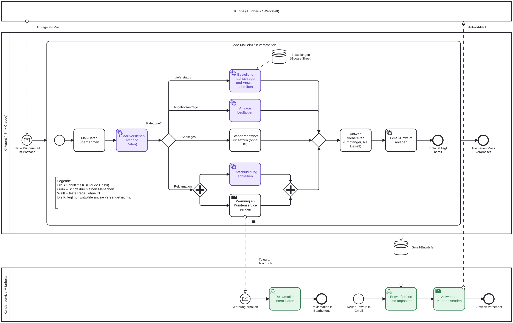

# Kundenanfragen-Agent (n8n + Claude)

Ein KI-Agent für den Kundenservice eines Autoteile-Großhändlers. Er liest eingehende Kundenmails, sortiert sie, zieht die wichtigen Daten heraus und legt passende Antwortentwürfe in Gmail an. Bei Fragen zum Lieferstatus schlägt er die Bestellung selbst in einer Tabelle nach. **Ein Mensch prüft jeden Entwurf und verschickt ihn selbst.**

Portfolio-Projekt, gebaut im Oktober 2026 · Version 1.1

## Das Problem

Ein Großhändler bekommt täglich viele Mails: Angebotsanfragen, Reklamationen, Fragen nach dem Lieferstatus. Jemand muss jede Mail lesen, einordnen, Bestellnummer und Kunde heraussuchen, im System nachschauen und eine Antwort schreiben. Das kostet Zeit und ist fehleranfällig.

## Was der Agent macht

1. **Neue Mail abholen:** Der Gmail Trigger prüft jede Minute das Postfach auf ungelesene Mails.
2. **Jede Mail einzeln verarbeiten:** Kommen mehrere Mails gleichzeitig, laufen sie nacheinander durch eine Schleife.
3. **Mail verstehen:** Claude ordnet die Mail einer von vier Kategorien zu und liefert strukturierte Daten: Kunde, Ansprechpartner, Bestellnummer, Artikel, Menge und eine Zusammenfassung in einem Satz. Fehlende Angaben bleiben leer, nichts wird erfunden.
4. **Je nach Kategorie antworten:**

| Kategorie | Was passiert | KI |
|---|---|---|
| Lieferstatus | Ein KI-Agent sucht die Bestellung in einer Google-Tabelle und schreibt eine Antwort mit Status und voraussichtlichem Termin. Ohne gültige Bestellnummer fragt er höflich nach. | Agent mit Werkzeug |
| Angebotsanfrage | Eingangsbestätigung, Nachfrage nach fehlender Menge oder Firmenanschrift. Keine Preise, Rabatte oder Lieferzeiten. | Chain |
| Reklamation | Entschuldigung ohne Zusagen zu Ersatz, Gutschrift oder Terminen. Gleichzeitig geht eine Warnung per Telegram an den Kundenservice. | Chain |
| Sonstiges | Fester Textbaustein, der den Eingang bestätigt. | keine |

5. **Antwort vorbereiten:** Alle Zweige laufen in einem Baustein zusammen, der Antworttext, Empfänger und „Re:“-Betreff vereinheitlicht.
6. **Gmail-Entwurf anlegen:** Die Antwort landet als Entwurf im Postfach. Es wird nichts automatisch verschickt.

## Prozessdiagramm

Das Diagramm oben ist in **BPMN 2.0** modelliert und zeigt alle Beteiligten: Kunde, KI-Agent und Kundenservice-Mitarbeiter.

- [`docs/Kundenanfragen-Agent.bpmn`](docs/Kundenanfragen-Agent.bpmn): die bearbeitbare Datei, zum Beispiel auf [demo.bpmn.io](https://demo.bpmn.io) öffnen
- [`docs/Kundenanfragen-Agent.svg`](docs/Kundenanfragen-Agent.svg) und `.png`: das Diagramm als Bild

Lila Schritte nutzen KI, grüne erledigt ein Mensch, weiße folgen festen Regeln.

## Technik

- **n8n** (selbst gehostet, Docker auf dem Mac)
- **Claude Haiku 5.5** über die Anthropic API
- **Gmail** (Trigger und Entwürfe), **Google Sheets** (Bestelldaten), **Telegram** (Warnung bei Reklamationen)
- n8n-Bausteine: Gmail Trigger, Loop Over Items, Edit Fields, Basic LLM Chain, Structured Output Parser (JSON Schema), Switch, AI Agent mit Google-Sheets-Werkzeug, Telegram, Gmail

## Einrichten

1. **Workflow importieren:** In n8n oben rechts „…“ → „Import from File“ → `workflow/kundenanfragen-agent.json`.
2. **Zugänge anlegen.** Der Export enthält bewusst keine Passwörter oder Schlüssel. Diese Zugänge musst du selbst anlegen und in den Bausteinen auswählen:
   - Anthropic API (API-Schlüssel aus der Claude Console)
   - Google Sheets OAuth2 und Gmail OAuth2 (eigenes Google-Cloud-Projekt mit aktivierter Sheets- und Gmail-API)
   - Telegram (Bot-Token von @BotFather) und deine Chat-ID im Baustein „Warnung Reklamation“
3. **Testdaten:** `testdaten/bestellungen-testdaten.csv` in eine Google-Tabelle importieren, Spalte A (Bestellnummer) als Text formatieren und die Tabelle im Werkzeug „Bestellungen“ auswählen.
4. **Testen:** Eine Mail an das verbundene Postfach schicken und im Gmail Trigger „Fetch Test Event“ klicken, danach den Workflow einmal komplett ausführen.
5. **Aktivieren:** „Publish“. Der Trigger fragt dann jede Minute das Postfach ab.

> **Tipp:** Für den Gmail Trigger ein eigenes Test-Postfach verwenden, nicht das private. Der Trigger bekommt Lesezugriff auf das ganze Postfach.

## Sicherheit und Grenzen

- **Mensch in der Schleife:** Der Agent schreibt nur Entwürfe. Preise, Ersatz, Gutschriften und feste Termine sagt die KI nie zu, das steht ausdrücklich in den System-Nachrichten.
- **Keine erfundenen Daten:** Status und Termine kommen nur aus der Tabelle. Ein Negativtest mit einer nicht existierenden Bestellnummer ist bestanden.
- **Neutrale Anrede:** „Guten Tag“ plus Name statt „Herr“ oder „Frau“, weil die KI das Geschlecht aus Vornamen nur raten kann.
- **Läuft lokal:** Nur solange der Rechner wach ist. Die Google-App ist im Testmodus, Anmeldungen laufen dort nach etwa 7 Tagen ab. Für Dauerbetrieb müsste n8n auf einen Server und die Google-App veröffentlicht werden.
- **Kosten:** Etwa 1.600 Tokens pro Mail, mit Haiku Bruchteile eines Cents.

## Tests

16 Testfälle bestanden, unter anderem:

- Lieferstatus mit vorhandener Bestellung (4711, versendet), mit Rückstand ohne Termin (4714) und mit nicht existierender Nummer (9999)
- Angebotsanfrage ohne Firma, Bestellnummer und Menge: Felder bleiben leer, nichts erfunden
- Reklamation: Telegram-Warnung und Entschuldigung ohne Versprechen
- Sonstiges mit und ohne bekannten Ansprechpartner
- Live-Test mit echter Mail über den Gmail Trigger
- Zwei Mails innerhalb von 20 Sekunden: zwei passende Entwürfe (Version 1.1)

## Was ich dabei gelernt habe

- **Strukturierte Ausgabe** mit JSON Schema statt freiem Text, inklusive erlaubter leerer Felder und fester Kategorien.
- **So einfach wie möglich:** Agent nur dort, wo die KI ein Werkzeug braucht. Chain, wenn alle Infos da sind. Gar keine KI, wenn die Antwort immer gleich ist.
- **KI übernimmt Beispiele wörtlich** und befolgt klare Anweisungen besser als Verbote. Wichtige Änderungen mehrmals testen, weil KI nicht jedes Mal gleich antwortet.
- **Grün heißt nicht richtig:** Nach jedem Test den Inhalt prüfen, nicht nur den Haken.
- **Daten über KI-Bausteine hinweg:** `.first()` statt `.item`, wenn KI-Bausteine die Zuordnung unterbrechen. Seit Version 1.1 sorgt die Schleife dafür, dass das auch bei mehreren Mails stimmt.

## Versionen

- **1.0** (16.10.2026): Gmail Trigger, vier Zweige, Gmail-Entwürfe, Telegram-Warnung
- **1.1** (16.10.2026): Schleife „Mails einzeln verarbeiten“. Behebt vertauschte Empfänger und Betreffzeilen, wenn mehrere Mails gleichzeitig ankommen.

## Nächste Schritte für den echten Einsatz

Für das Portfolio habe ich den Umfang bewusst auf den Kernprozess begrenzt. Würde der Agent bei einem Kunden dauerhaft laufen, kämen diese Punkte dazu:

- Verarbeitete Mails mit dem Label „KI-bearbeitet“ markieren, damit im Postfach sichtbar ist, was schon einen Entwurf hat
- Entwurf im selben Gesprächsverlauf anlegen (Thread ID)
- Fehler-Benachrichtigung per Error Trigger, zum Beispiel wenn das API-Guthaben leer ist
- Gemeinsame Regeln wie Anrede und Grußformel an einer zentralen Stelle pflegen statt in vier System-Nachrichten
